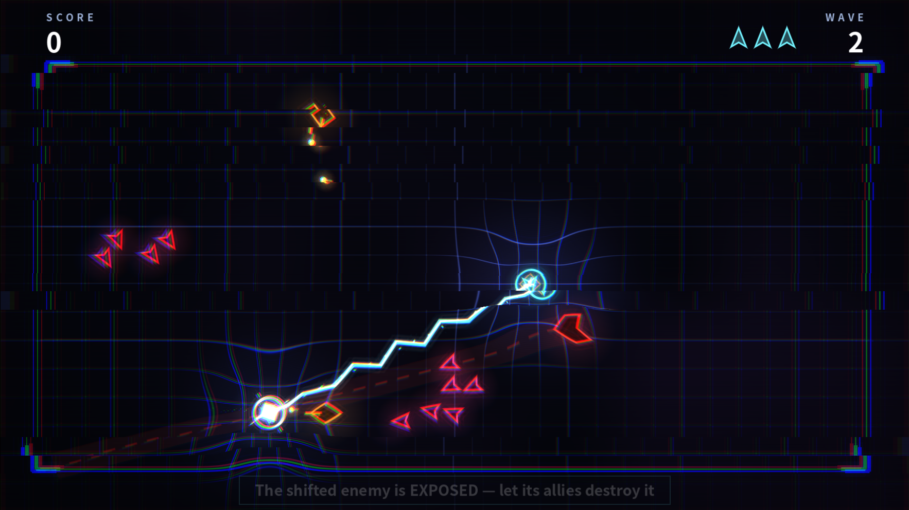

# COUNTERSHIFT

テーマ「SHIFT」のアリーナアクション。武器はない。できるのは、敵と位置を入れ替える（SHIFT する）ことだけ。
入れ替えられた敵は数秒間「無防備」になり、味方の弾・突進・レーザー・群れに壊される。壊れた敵は爆発し、まわりを巻きこむ。

A one-screen arena game for the theme "SHIFT". You have no weapon: hold SHIFT to slow time, aim, release to trade
places with an enemy. The enemy you leave behind is exposed to everything its allies were about to do to you.



Godot 4.7.2（GL Compatibility）。画像・音声ファイルは使っていない（図形はコードで描画、効果音と音楽は起動時に合成）。

## 遊ぶ / Play

- **Web 版（itch.io）**: <https://useseka.itch.io/countershift> — ブラウザーでそのまま遊べる。キーボード専用。
  Play in the browser on itch.io (keyboard only).
- **ソースコード / Source**: <https://github.com/sekaikaeru/countershift>（公開しているが、オープンソースではない。下の「ライセンス」を参照）
- **Game Off 2026** 提出作品（テーマ: SHIFT）。Made for Game Off 2026.
- 手元で動かす: Godot 4.7 で `project.godot` を開いて実行する。Web 版を自分で書き出す場合は下の「確認用コマンド」。
  macOS / Windows 用の実行ファイルは配布していない。

## 世界ランキング / World ranking

タイトルの「世界ランキング」、またはリザルト画面の TAB で開く。初回は名前を 1 回入力する（日本語で入力できる）。
登録もメールも不要で、送信されるのは名前とプレイの記録だけ。

送られたスコアはそのまま信用しない。ゲームは入力を記録し、検証役が同じ Web ビルドでプレイ全体を再現して、
一致したスコアだけを載せる。検証役は作者の手元のパソコンで動いているため、**そのパソコンがスリープ中・停止中の
間は検証が進まない**。記録は保存されていて、検証役が戻ったときに確認される（その間は「検証待ち」と表示される）。
サーバーに接続できなくても、ゲームはそのまま遊べる。

Scores are never trusted as sent: the game records your inputs and a verifier replays the whole run in the same
Web build before a score is listed. The verifier runs on the developer's own computer; while it is asleep or off,
runs wait ("Waiting for verification") and are checked when it comes back.

仕組み・保証する範囲・運用の手順は [docs/ONLINE-RANKING.md](docs/ONLINE-RANKING.md)。
自分の環境で一式を動かすには（Chrome が必要。外部には接続しない）:

```bash
node server/dev.mjs
```

`http://127.0.0.1:8787/` で、ゲーム・ランキング API・検証役がまとめて動く。

## 操作 / Controls

| キー | 動作 |
|---|---|
| 矢印キー / WASD | 移動。SHIFT を押している間は、ねらう方向 |
| SHIFT または SPACE（押し続ける） | 時間がゆっくりになり、敵をねらう |
| SHIFT または SPACE（はなす） | ねらった敵と位置を入れ替える |
| 同じ方向をもう一度押す | その方向の、次に遠い敵をねらう |
| ESC / P | 一時停止 |
| TAB（リザルト画面） | 世界ランキングを開く |
| N（リザルト・ランキング画面） | 名前の入力・変更 |
| F11（メニューでは F も） | フルスクリーン |

Windows では SHIFT を 5 回続けて押すと「固定キー」の確認が出ることがある。その場合は SPACE を使う。

## 構成

| 場所 | 内容 |
|---|---|
| `scripts/sim.gd` | ゲームの規則すべて（ノードなし）。敵 5 種、入れ替え、連鎖、ウェーブ生成 |
| `scripts/bot.gd` | 自動プレイ。タイトルのデモと、ヘッドレステストの両方で使う |
| `scripts/view.gd` | 描画とエフェクト（パーティクル、衝撃波、画面の揺れ） |
| `scripts/ui.gd` | タイトル・あそびかた・HUD・一時停止・リザルト |
| `scripts/audio.gd` | 効果音と音楽の合成（4 トラックを同期再生し、戦況で混ぜ方を変える） |
| `scripts/replay.gd` | 入力リプレイの記録と再計算（ランキングの検証に使う） |
| `scripts/online.gd` | ランキング API との通信（すべて非同期。失敗してもゲームは止まらない） |
| `server/` | ランキング API（Cloudflare Workers + D1 用）、ローカル実行、検証役、管理コマンド、テスト |
| `scripts/loc.gd` | 日本語・英語の文言。列を足せば言語を追加できる |
| `shaders/` | 背景グリッドのゆがみ、画面全体の色ずれ・ブルーム・衝撃波 |

## 確認用コマンド

```bash
GODOT=/Applications/Godot.app/Contents/MacOS/Godot   # Godot 4.7 の実行ファイルの場所
$GODOT --headless --path . -s tools/bot_test.gd -- 12 1.0    # 自動プレイ 12 回（引数: 回数、腕前 0〜1）
$GODOT --headless --path . -- --flowtest=1                   # キー入力で全画面を一巡する操作テスト
$GODOT --headless --path . -- --uicheck=1                    # 全画面・両言語で文字のはみ出しを数える
$GODOT --headless --path . --export-release "Web" build/web/index.html
```

画面の確認用に、起動引数（`-- --auto=game --lang=ja --seed=7`）または Web の URL（`?auto=game&lang=ja`）で
自動プレイを始められる。`auto` を付けた実行ではセーブを書かない。

## AI の利用 / Use of AI

このゲームは生成 AI を使って制作した。ゲームデザイン、すべてのプログラム（ゲーム本体、シェーダー、ランキング
サーバー、テスト）、絵を描くコード、効果音と音楽を合成するコード、文章は、Claude（Anthropic の AI モデル。
Claude Code 経由）が作者の指示のもとで作成した。作者は目標の設定、判断、実機でのテストプレイ、公開の各段階の
承認を行った。AI が生成した画像・音声・動画のファイルは使っていない（画像・音声ファイル自体がない）。

This game was made with generative AI. The design, all code (game, shaders, ranking server, tests), the code that
draws the graphics and synthesises the audio, and the text were written by Claude (Anthropic's AI model, through
Claude Code) under the direction of the developer, who set the goals, made the decisions, play-tested on a real
machine and approved every release step. No AI-generated image, audio or video files are used.

## ライセンス / License

- **ゲーム本体（このリポジトリのコード・シェーダー・文書）**: © 2026 seka. All rights reserved.（[LICENSE](LICENSE)）
  オープンソースライセンスは付けていない。ソースは Game Off 2026 の規則に従って公開しており、読むこと、
  GitHub 上で fork すること（GitHub の利用規約の範囲）はできるが、それ以外の利用・改変・再配布には作者の許可が必要。
  The game's own code, shaders and documents are **not open source**: all rights reserved. The source is public
  because Game Off requires it. You may read it and fork it on GitHub as GitHub's terms allow; any other use,
  modification or redistribution needs the author's permission.
- **Godot Engine 4.7.2**: MIT License。Copyright (c) 2014-present Godot Engine contributors.
  Copyright (c) 2007-2014 Juan Linietsky, Ariel Manzur. <https://godotengine.org/license>
  エンジンに含まれる第三者のソフトウェアの表記は
  [docs/release/THIRD-PARTY-NOTICES.md](docs/release/THIRD-PARTY-NOTICES.md)（エンジンから生成）。
- **フォント**: Noto Sans JP Bold。Copyright 2014-2021 Adobe (http://www.adobe.com/), with Reserved Font Name 'Source'. SIL Open Font License 1.1
  （[fonts/NotoSansJP-LICENSE.txt](fonts/NotoSansJP-LICENSE.txt)）。Noto は Google Inc. の商標。
- それ以外の素材は使っていない。画像・音声ファイルはなく、図形はコードで描画し、効果音と音楽は起動時に合成している。
